# MALING（码灵）开箱即用 SOP

码灵是连接本地 AI Agent 的桌面客户端。你可以在同一个窗口中使用 Claude Code、Codex、CodeBuddy 等 Agent，完成对话、代码修改、工作流执行和结果审阅。

行内用户可先查看[在线界面预览](http://maling.weoa.com/site-by-maling/zh/demo)；实际操作本机项目仍需安装客户端并准备 Agent。

> **适用范围**：以行内 Windows / VDI 用户为主，补充开源版与 macOS 入口。操作名称采用简体中文界面。
>
> **内容核对日期**：2026-11-06。本文按当前仓库实现及 0.20.0 / 0.21.0 发布说明整理；截图作为位置示意，截图中的版本号不代表当前发布版本。入口不一致时先核对版本和发行渠道。
>
> **使用前先分清**：安装码灵 ≠ 安装 Agent；Agent 能启动 ≠ 已通过客户端环境诊断；创建定时任务 ≠ 已经开始执行；IM 扫码授权成功 ≠ 接收账号已绑定且渠道可用。

## 导航：按你现在要做的事阅读

| 你现在要做什么 | 直接阅读 |
| --- | --- |
| 还没安装客户端 | [1. 下载、安装与更新](#install) |
| 已经在用，想了解近期新增能力 | [近期功能速览](#recent-features) |
| 装好了，想完成第一次对话 | [2. 首次使用：跑通一条 Direct 会话](#quick-start) |
| 不知道选 Direct、工作流还是 AUTO | [3. 会话与运行模式](#run-modes) |
| 想先保存消息、排队发送 | [3.2 草稿箱与待发送队列](#drafts-and-queue) |
| 离开电脑后用飞书 / 企微处理权限和提问 | [4.4 IM 远程干预与通知](#im-remote) |
| 查看代码、提交更改或设置定时任务 | [4. 常用功能操作](#daily-use) |
| 配置 MCP、SKILL、角色、Multica 或代码图谱 | [5. 进阶配置](#advanced-use) |
| 报错、卡住、没收到通知 | [6. 常见问题与排障](#troubleshooting) |
| 需要把问题反馈给维护者 | [7. 日志与问题反馈](#feedback) |

**入口速查**：侧边栏「Agent」管理 Agent；「上下文」管理 MCP、SKILL、角色；「运行模式」管理工作流和 AUTO；「更多」中有定时任务和需求管理；「设置」中有通用、个性化和高级；顶部「帮助」中有数据分析、更新日志和按渠道开放的用户反馈。

<a id="recent-features"></a>

## 近期功能速览：已有用户从这里开始

以下整理自 **0.20.0（2026-10-19）和 0.21.0（2026-11-05）**，具体操作见对应章节；完整变化可在客户端「帮助 → 更新日志」查看。

| 新增或完善的能力 | 适合什么场景 | 操作指引 |
| --- | --- | --- |
| 飞书远程干预与通知、已有应用选择 | 离开电脑后确认权限、回答 Agent 提问、做人工检查或接收结果 | [4.4 飞书 / 企微接入](#im-remote)；扫码后仍需私聊绑定 |
| 草稿箱、待发送队列与打断确认 | 先保存稍后再发，或让下一条需求排队等当前回复结束 | [3.2 草稿与队列](#drafts-and-queue)；草稿最多 20 条，队列最多 10 条 |
| 首次引导与本机 Agent 自动发现 | 新装客户端，或重新配置默认 Agent、模型和内置工作流 | [2.3 首次启动引导](#quick-start) |
| 最近会话与会话搜索 | 在多个项目中找到之前的对话 | [4.7 查找会话](#find-conversations) |
| 工作流画布布局方向和全屏 | 查看较复杂的流程，减少缩放和拖拽 | [3.3 工作流](#workflow-basics) |
| 角色文件导入、Multica 交付与 SKILL 同步 | 复用角色、处理开发 / 测试任务、传递上游成果 | [5.3–5.5 进阶配置](#advanced-use)；行内集成取决于渠道和账号权限 |

<a id="install"></a>

## 1. 下载、安装与更新

### 1.1 Windows / VDI：从安装包开始

**行内用户**：打开群看板中的「码灵更新日志」，下载安装包，双击后按安装向导完成安装。

**开源版用户**：从 [GitHub Releases](https://github.com/diodeme/Gold-Band/releases) 选择适合操作系统和架构的安装包。开源版客户端名称为 **Gold Band**；行内版名称为 **MALING**，更新源和部分集成入口存在差异。

安装成功的判断：可以打开客户端，并看到首次启动引导或会话主页。

<details>
<summary>查看群看板和安装包下载位置</summary>

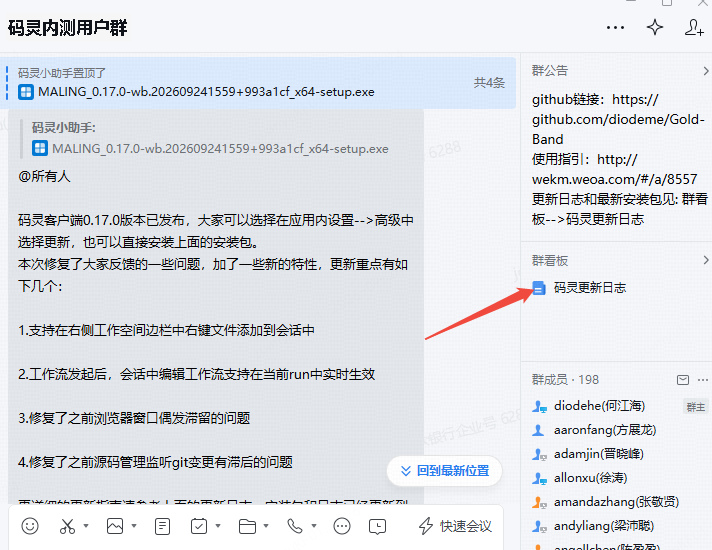

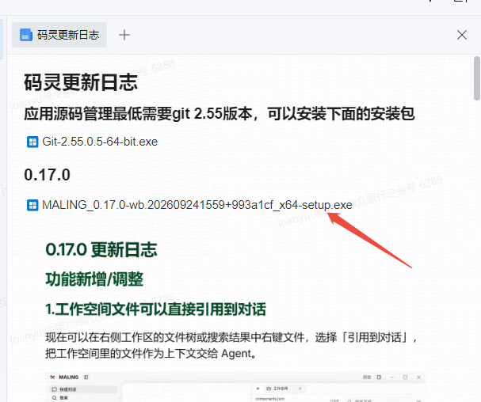

</details>

### 1.2 Windows VDI：可选的 PowerShell 下载方式

**仅适用于能访问行内网络的 Windows x64 环境**。在 PowerShell 中执行下列命令，下载安装包后按安装器提示操作：

```powershell
$manifest = Invoke-RestMethod -Uri 'http://maling.weoa.com/api/file/download/latest.json'
$installerUrl = $manifest.platforms.'windows-x86_64'.url
$installerPath = Join-Path $env:TEMP 'MALING-setup.exe'
Invoke-WebRequest -Uri $installerUrl -OutFile $installerPath
Start-Process -FilePath $installerPath
```

如果下载失败，先确认当前 VDI 能访问行内地址，再尝试群看板安装包。以上内网地址不适用于开源版用户。

### 1.3 macOS 安装

macOS 安装包同样从 [GitHub Releases](https://github.com/diodeme/Gold-Band/releases) 下载。当前仓库的发行说明记录了未做 Developer ID 签名和公证的安装限制；遇到“无法验证开发者”“应用已损坏”等提示时，按 [macOS 安装与排障指南](guide/macos-install.zh-CN.md) 核对安装包和处理方式。

### 1.4 更新客户端

**方式一**：设置 → 高级 → 更新 →「检查更新」，按界面提示完成更新或重启。

**方式二**：下载同一发行渠道的新安装包，覆盖安装。

正常覆盖升级会保留用户配置和会话。更新前保存正在编辑的文件，处理或停止运行中的任务；不要通过删除数据目录来“重新安装”。如果检查更新失败，见 [Q03：更新失败](#faq-update)。

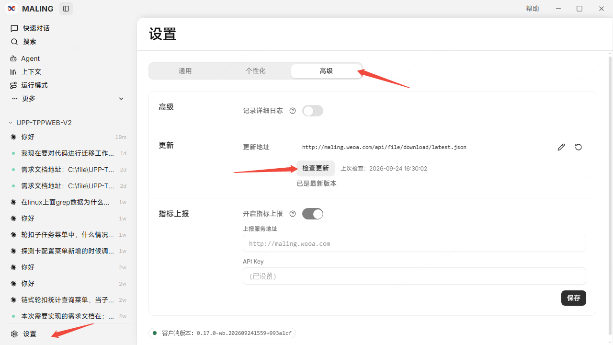

<a id="quick-start"></a>

## 2. 首次使用：跑通一条 Direct 会话

### 2.1 准备条件

| 需要准备什么 | 用来做什么 | 怎么确认 |
| --- | --- | --- |
| 本地项目文件夹 | Agent 读取和修改的工作空间 | 选择你要处理的项目根目录，确认自己有访问权限 |
| Node.js、npm、npx | 启动依赖 npm 的 Agent / ACP 适配器 | 首次启动引导的「运行环境」检测通过 |
| 一个 Agent 及其登录 / 授权 | 实际执行 AI 任务 | 按供应商指引完成安装和登录，再通过码灵「环境诊断」 |
| Git | 源码管理、分支和 worktree | 引导检查通过；暂时跳过不会替你准备 Git 功能 |
| 对应网络 | 下载适配器、调用模型和访问组织服务 | 内网地址需要行内网络，模型与登录服务需要各自可达 |

**工作空间**是你选择的项目文件夹；**Agent**是实际干活的工具；**模型**是 Agent 提供的可选配置。码灵负责连接和展示，模型访问资格、登录状态及额度仍取决于相应 Agent / 服务。

### 2.2 准备 Claude Code 或 CodeBuddy

已经有本机可用 Agent 的用户可直接进入下一节，无需重复安装。行内常用两种准备路径：

#### Claude Code

按 [行内 Claude Code 安装指引](http://docs.weoa.com/docs/RKAWVRNyVGuY5rk8) 完成安装和登录，再回到码灵检测。该链接需要相应内网访问权限；其他用户使用自己组织或供应商提供的安装指引。

#### CodeBuddy CLI

本节接入的是 **CodeBuddy CLI**，客户端内选择 **CodeBuddy**；不要把其他桌面产品的安装状态当作这个 CLI 已就绪。

1. 在已准备好 Node.js/npm 的 PowerShell 中安装并启动：

   ```powershell
   npm install -g @tencent-ai/codebuddy-code
   codebuddy
   ```

2. 在登录选择中选择 **Log in via Chinese Site**。
3. 选择 **SSO 登录**，进入企业登录流程。
4. 当前行内接入说明中的企业域名为 `e19jt155vs08tl`；仅该组织用户使用此值，其他组织填写自己的域名。
5. 按登录页要求勾选服务协议，选择「切换扫码登录」，使用企业微信扫码完成登录。
6. 回到码灵，在「Agent」中添加或检查 **CodeBuddy**，执行「环境诊断」。

**成功标志**：登录完成后，码灵中的 CodeBuddy 环境诊断通过。只在网页登录成功，还不代表客户端已能调用。

<details>
<summary>查看 CodeBuddy 登录入口</summary>

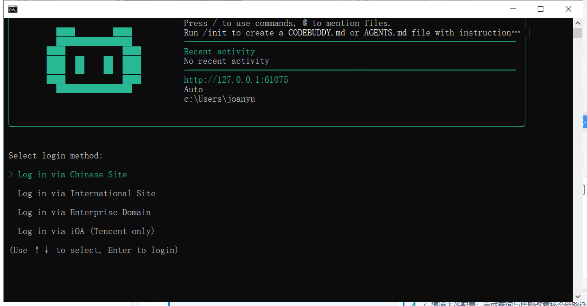

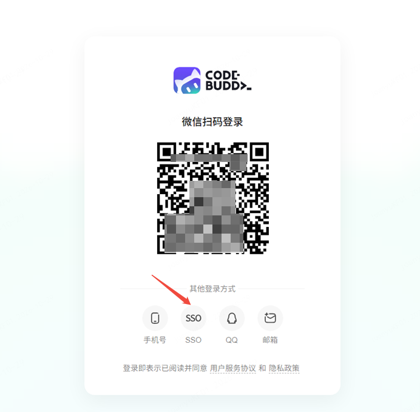

</details>

安装报 npm 错误时，先按 [Q01](#faq-npm) 判断版本、网络或缓存问题。

### 2.3 完成首次启动引导

首次启动按 **Git → 运行环境 → Agent** 的顺序检查：

1. **Git**：按页面提示安装或检测；暂时跳过后，Git 和 worktree 相关功能仍会检查前置条件。
2. **运行环境**：确认 Node.js、npm、npx 可启动且组合兼容。安装或切换版本后，重新打开客户端并点击「重新检测」。
3. **Agent**：先完成所需 Agent 的安装和登录，再重新检测；诊断成功的 Agent 会保存到管理列表。
4. 选择默认 Agent、模型和权限，查看默认工作流的应用预览，再点击「应用并完成」。

已跳过或想重新配置：设置 → 通用 →「引导与工作流」→「重新运行引导」。需要统一调整内置工作流时，使用同处的「配置默认项」。

### 2.4 确认 Agent 已就绪

**入口**：侧边栏「Agent」。

1. 如果列表里已有引导发现的 Agent，直接检查其状态。
2. 如果没有，点击「新增 Agent」，从目录选择所需 Agent 并保存。
3. 点击「环境诊断」，查看结果；失败时展开诊断原因，按 [Q04](#faq-agent) 处理。
4. 诊断通过后，回到会话选择 Agent；模型、权限、思考强度等以该 Agent 实际返回的能力为准。

内置 Agent 的启动命令和参数由客户端维护，通常无需手填。只有接入自定义 ACP Agent 时，才需要自行配置启动方式。

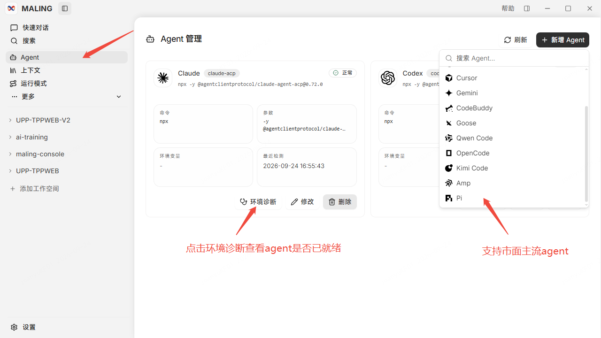

### 2.5 添加工作空间并发送第一条消息

**入口**：侧边栏「添加工作空间」→ 选择项目根目录 →「快速对话」。

1. 在输入区顶部确认工作空间；第一次使用选择主工作区，并核对分支。
2. 处理模式选择 **Direct**。
3. 选择已诊断通过的 Agent；按需要选择模型和权限。没有某个选项时，先看 [Q05](#faq-model)。
4. 先发送下面这条只读需求，确认链路正常：

   ```text
   请先阅读当前项目的目录结构和 README，说明项目用途、启动方式和测试方式。
   这次只分析，不修改任何文件。
   ```

5. 若出现权限请求或提问，在对应卡片中处理；等 Agent 返回结果。

**成功标志**：Agent 返回了与当前项目相符的分析，且没有启动、登录或诊断错误。之后再尝试代码修改，并在右侧查看实际文件变化。

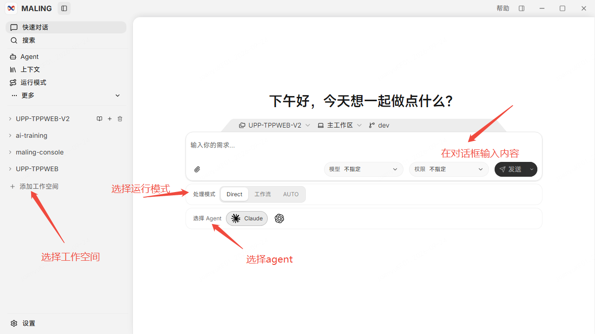

<a id="run-modes"></a>

## 3. 会话与运行模式

### 3.1 三种模式怎么选

| 模式 | 适合场景 | 开始前要确认 |
| --- | --- | --- |
| **Direct** | 问问题、了解项目、修改范围小、边聊边确认 | 工作空间、Agent、模型和权限 |
| **工作流（Workflow）** | 已知开发、测试、审查等阶段，需要明确结果判定 | 模板、各节点 Agent / 模型 / 角色、成功条件 |
| **AUTO（AI-DYNAMIC）** | 需求复杂，希望 AI 动态拆分、并行、合并和验收 | Agent 策略、验收标准、节点及并行等执行上限、Git 条件 |

**新用户先用 Direct。** 工作流和 AUTO 包含更多验证及循环，通常比一次直接对话花费更多时间和 token。AUTO 仍受运行时校验、权限和执行上限约束。

描述需求时，尽量同时给出：**目标、修改范围、限制、如何验收**。例如：“修复登录按钮重复提交；只改登录模块；失败时恢复按钮；用相关测试证明重复点击只发一次请求。”

<a id="drafts-and-queue"></a>

### 3.2 Direct：追问、附件、草稿箱与待发送队列

- 在输入区选择 Agent、模型、权限和该 Agent 支持的思考强度。切换后重新核对可选项。
- 附件通过纸夹按钮、拖拽或粘贴添加；每次最多 **10 个**、单文件不超过 **25 MB**。当前输入区在总计超过 **50 MB** 时会提示超限，遇到提示请减少附件或拆分发送。
- 工作空间文件树中右键「引用到对话」，可以向 Agent 指明文件路径；文件引用与复制一份附件不同。
- 选中消息、代码或 Diff 片段，可以「引用」到下一条消息。
- Direct 的「停止」取消当前回复；之后可以继续普通对话。

**先区分“保存”和“发送”**：草稿箱只保存内容；待发送队列用于安排后续发送；「立即发送」会在必要时先停止当前回复。

| 你想做什么 | 操作 | 成功标志与注意事项 |
| --- | --- | --- |
| 先记下来，暂不发给 Agent | 在已有会话输入区打开「草稿箱」→「存入草稿箱」 | 当前会话草稿数增加；正文、文件引用、角色和附件引用一并保留，最多 20 条 |
| 取回草稿继续写 | 先处理输入框中的现有内容，再在草稿箱选择「取出到输入框」 | 内容回到输入框，检查后再发送；取出本身不会执行任务 |
| 不打断当前回复，稍后继续一条需求 | 回复进行中输入内容并「加入队列」 | 内容出现在「待发送」列表中，最多 10 条；可编辑、删除或拖动调整顺序 |
| 每轮结束后依次发送 | 在待发送区域开启「自动发送」 | 当前回合结束后按队列顺序发送；关闭后由你逐条「立即发送」 |
| 会话停止或发送失败后继续排队 | 先处理停止 / 失败原因，再点击队列的「恢复」 | 队列退出暂停，继续自动发送；未发送内容会保留，重启后也可查看 |
| 当前回复方向错了，需要马上纠正 | 对目标条目点「立即发送」，按提示「停止并发送」 | 会中止当前回复再发送该条；不要把它当作普通排队 |

「设置 → 高级 → 待发送」中的「立即发送前确认打断当前回复」默认开启；确认框里的「后续不再提示」也会修改这一偏好。需要恢复确认时到该处重新开启。

**成功标志**：保存的内容能从当前会话取回；发送后消息进入对话并得到 Agent 响应。仅出现在草稿箱或待发送列表不代表 Agent 已收到。队列不自动发、草稿按钮灰色时，见 [Q25](#faq-drafts-queue)。

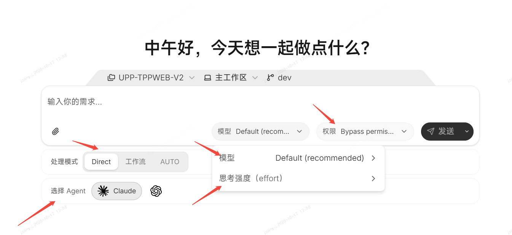

<a id="workflow-basics"></a>

### 3.3 工作流：先用模板，再调整节点

**运行入口**：快速对话 →「工作流」→ 选择模板。**管理入口**：侧边栏「运行模式」→「工作流模式」。

可选内置模板包括默认轻量、默认完整及按渠道提供的开发构建部署工作流，以当前列表为准。首次使用优先选贴近目标的模板，确认每个节点已绑定可用 Agent 和模型后再发送需求。

需要自定义时，在画布中添加节点、配置 Agent / 模型 / 权限 / 角色和目标，再连接成功、失败或新一轮的路径。自动输出验证和人工 check 是两种结果判定方式，需要按节点用途选择。

**成功标志**：模板校验通过，任务可以发起，节点按配置推进；有人工 check 时，在卡片中选择「成功」或「失败」。

运行已经开始后，模板修改不会自动改写这次运行。停止后继续执行的区别见 [Q11](#faq-continue)，保存失败见 [Q12](#faq-workflow-validation)。

**查看较大流程**：在画布中选择「自动 / 横向 / 纵向」布局方向；编辑器和运行图都可全屏查看，按 `Esc` 退出后继续原来的编辑或检查。

<details>
<summary>查看工作流模板、画布和角色示例</summary>

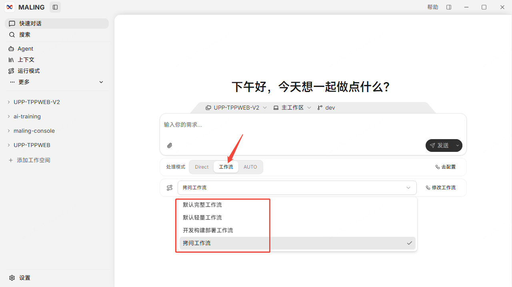

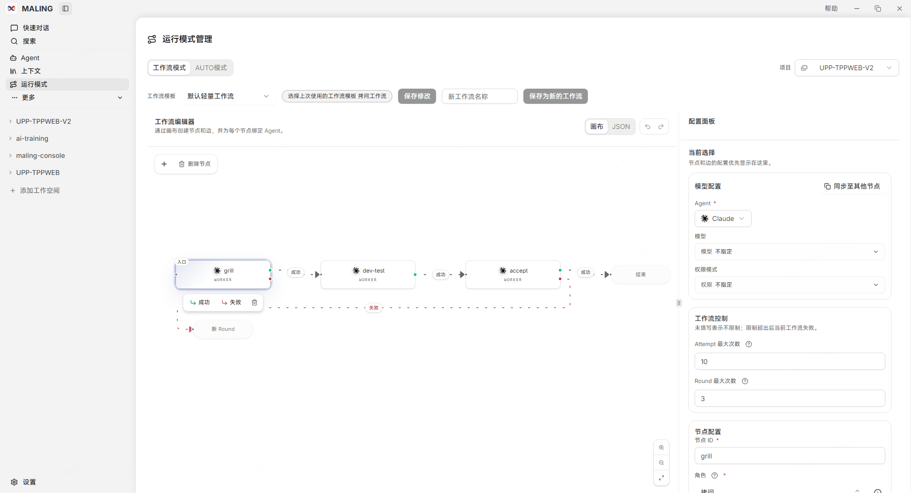

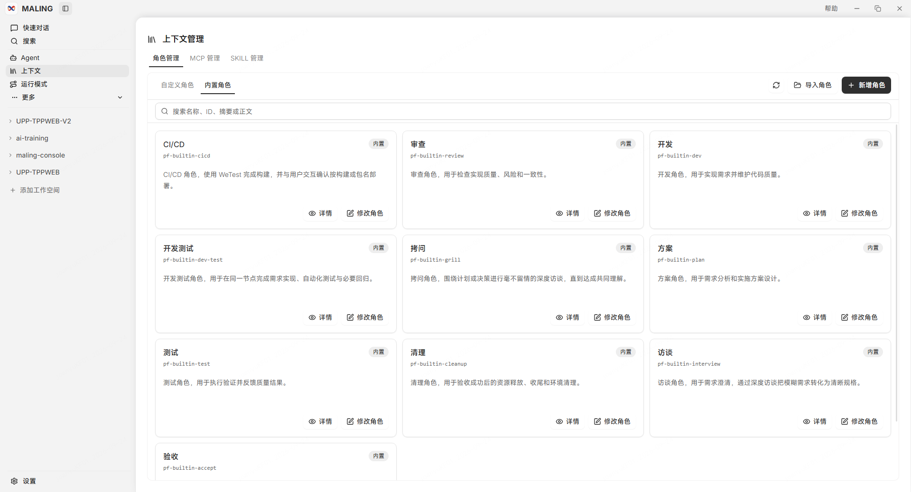

</details>

### 3.4 AUTO：写清目标，也设置执行边界

**入口**：快速对话 →「AUTO」；默认配置在「运行模式 → AUTO 模式」中管理。

1. 配置可用 Agent、模型和权限策略。
2. 写明目标、允许修改的范围和验收标准。
3. 按任务规模设置动态节点、并行、深度等上限，再发送。
4. 查看拆分、执行、合并与验收结果；需要用户输入时处理对应卡片。

AUTO 可通过 Git worktree 隔离子任务，合并阶段仍可能需要处理冲突。遇到反复执行或 token 消耗偏高，按 [Q13](#faq-auto) 检查目标和执行上限。

<details>
<summary>查看 AUTO 配置与执行示例</summary>

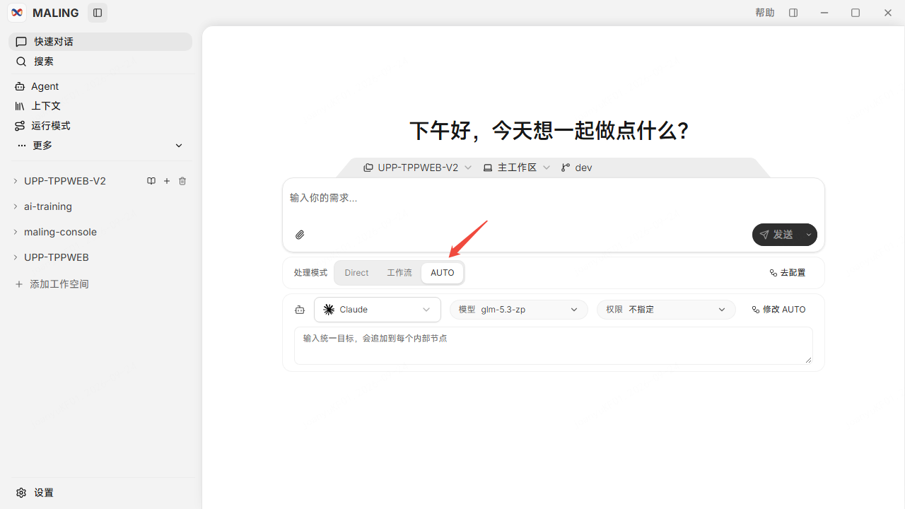

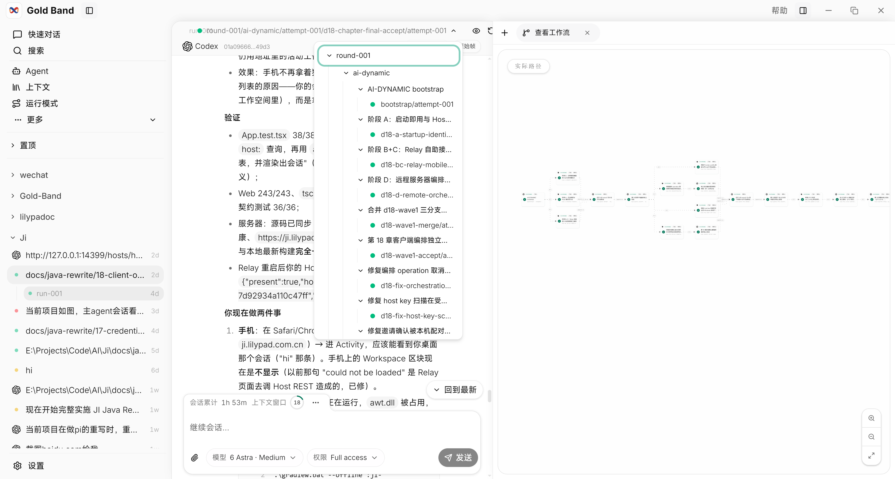

</details>

<a id="daily-use"></a>

## 4. 常用功能操作

### 4.1 查看文件、Diff 和任务产物

**入口**：右侧工作区的新增 Tab 入口，选择「工作空间」「源码管理」或会话中的产物、文件链接。

| 你要查看什么 | 去哪里 | 需要知道 |
| --- | --- | --- |
| 项目代码和配置 | 工作空间 | 跟随当前会话的主目录或 worktree，可查看和编辑 |
| 当前节点报告、运行文件 | 运行目录 / 产物 | 运行目录默认只读，不等于项目源码目录 |
| 代码改动 | 源码管理 / Diff | 核对文件和工作位置，再决定暂存或提交 |
| HTML 报告或网页 | 浏览器 | 文件树中的 HTML 默认先显示源码，可再选择在浏览器中打开 |

先审阅改动，再提交。切换会话后若目录与预期不同，先检查工作位置；工作树不可用时见 [Q15](#faq-worktree)。

<details>
<summary>查看文件、源码管理和浏览器入口</summary>

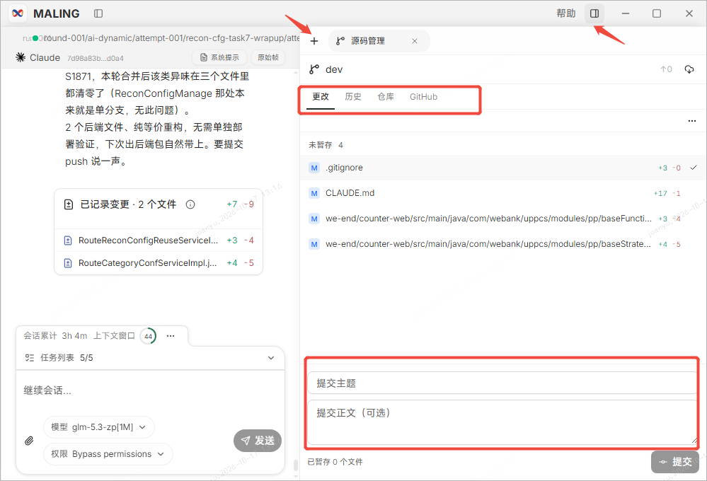

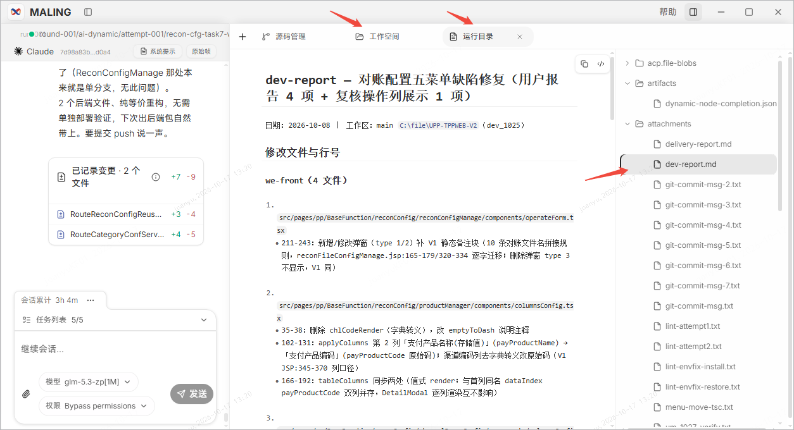

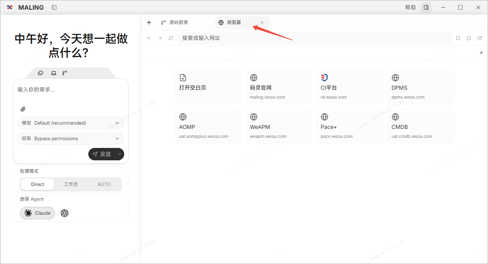

</details>

### 4.2 源码管理与 Git

**入口**：右侧工作区 →「源码管理」。

查看更改 → 打开 Diff → 暂存需要提交的文件 → 填写提交信息 → 提交。分支、历史、worktree 和远程操作在相应区域完成。GitHub 功能还取决于网络、账号和环境检测结果。

「放弃更改」会还原文件内容，操作前先审阅和备份；它与把普通文件移入回收站不是一回事。按钮灰色时见 [Q14](#faq-git)。

### 4.3 创建和检查定时任务

**入口一**：侧边栏「更多 → 定时任务 → 创建定时任务」。

**入口二**：在快速对话写好需求，点击发送按钮旁的下拉箭头 →「切换为创建定时任务」，再打开齿轮「定时任务设置」。

1. 确认工作空间、需求正文、附件和 Direct / 工作流 / AUTO 配置。
2. 选择单次、重复或 Cron，核对日期、时间和时区。
3. 选择会话策略：每次独立的任务选新会话；需要沿用上下文时，可在 Direct 中选择持续会话。
4. 保存后到列表查看下次执行时间和启用状态。
5. 可用「立即执行」检查一次运行；它不会改变原定的下一次计划时间。

**成功标志**：任务已启用、下次执行时间正确，执行历史中能打开对应运行。

**运行条件**：客户端要保持运行，电脑要保持可执行任务的状态，Agent 和所需网络要可用。「保持系统唤醒」只防止空闲导致的系统睡眠，不能在客户端退出、关机或强制休眠后代替客户端执行。创建任务不会马上跑一次，也不代表模型用量规则发生变化。

<details>
<summary>查看定时任务的两种入口、配置和执行历史</summary>

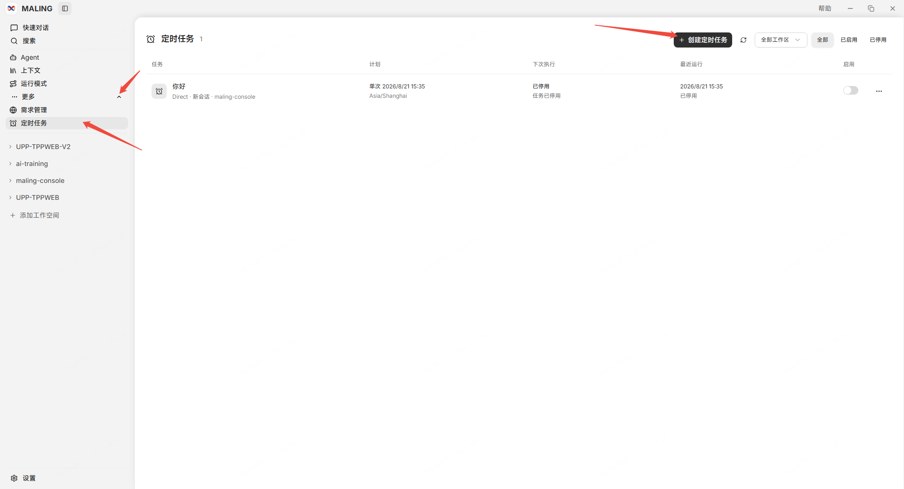

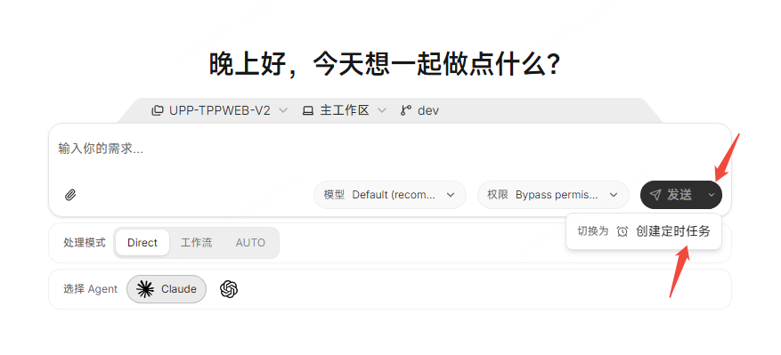

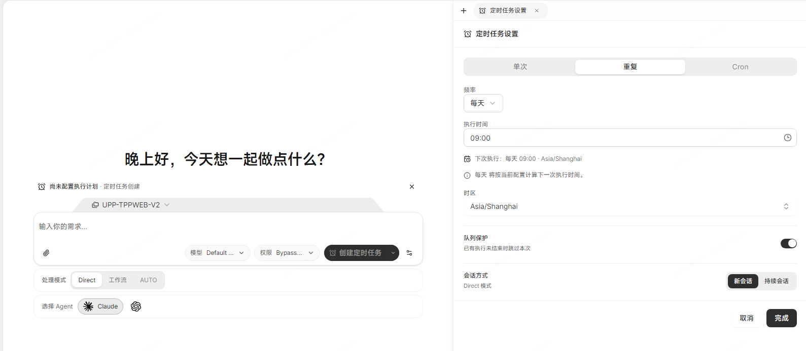

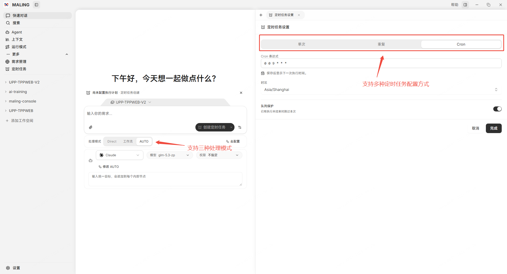

</details>

到点没跑，见 [Q17](#faq-schedule)。

<a id="im-remote"></a>

### 4.4 用飞书 / 企业微信远程干预与接收通知

适用于任务已经在本机运行、你希望离开电脑后在手机上处理确认或接收结果的场景。当前支持**企业微信和飞书**；普通微信尚未提供入口，Lark 国际版尚未完成验证，不按飞书已验证能力作保证。

**入口**：设置 → 通用 →「IM 远程干预与通知」。企业微信在上、飞书在下，两张卡片默认折叠；点击对应渠道右侧展开按钮查看设置。各渠道的启用开关、接收账号和通知偏好分别管理。

#### 4.4.1 飞书：从扫码到“可用”

1. 展开「飞书」，点击「扫码接入」。
2. 阅读权限说明：向你发送消息、读取你发给机器人的私聊消息、更新机器人卡片，以及读取姓名用于显示接收账号。确认后点击「同意并生成二维码」。
3. 用**准备接收通知的飞书账号**扫码。在飞书授权页面选择「已有应用」或创建新应用，并按页面提示完成授权。新建时填写便于辨认的机器人名称；已有应用应确认就是本次要连接的机器人。
4. 授权完成后，在飞书中打开**刚授权应用的机器人私聊**，用同一个扫码账号主动发送一条文字，例如“你好”，完成接收账号绑定。群消息、给其他机器人发消息或由其他人代发都不能完成这个绑定。
5. 回到码灵，确认渠道「启用」、状态为「可用」，并核对接收账号、App ID 和机器人名称。授权弹窗会在当前绑定可用后关闭；只看到二维码扫码成功仍需完成上一步。
6. 按下文选择通知类型；有改动时点击「保存通知设置」。企业微信的勾选不会自动替飞书保存。

**成功标志**：飞书卡片显示「可用」，接收账号正确；之后发生一次新的受支持干预或通知时，消息送达该机器人私聊。等待绑定、授权失败或缺少权限时，见 [Q22](#faq-feishu-onboarding)。

<details>
<summary>查看飞书设置与应用选择 / 创建页面</summary>

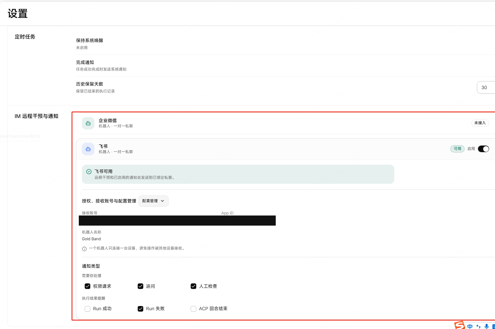

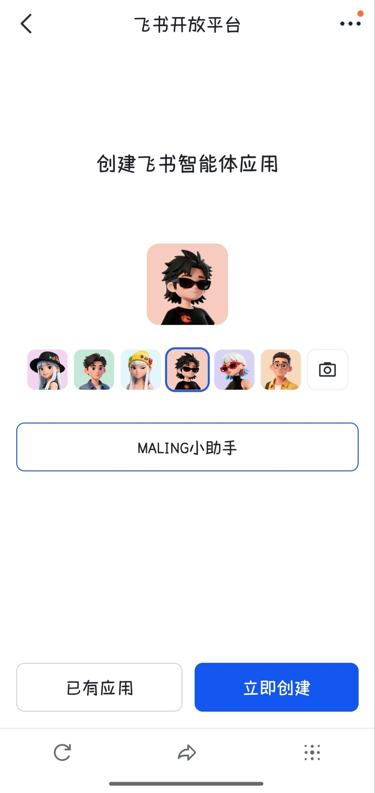

</details>

#### 4.4.2 企业微信：扫码后仍需私聊绑定

1. 展开「企业微信」，点击「扫码接入」，用目标企业微信账号扫码并确认授权。
2. 在企业微信中主动给本次授权的机器人发一条**一对一私聊消息**，完成绑定。
3. 回到码灵，确认渠道已启用、接收账号正确且状态变为「可用」。只显示连接成功或「等待绑定」，还不能算通知已接通。
4. 选择通知类型；有改动时点击「保存通知设置」。

<details>
<summary>查看企微接入、通知选项和干预卡片</summary>

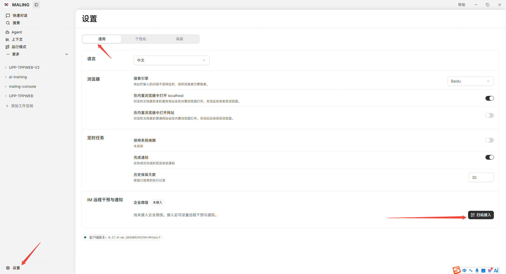

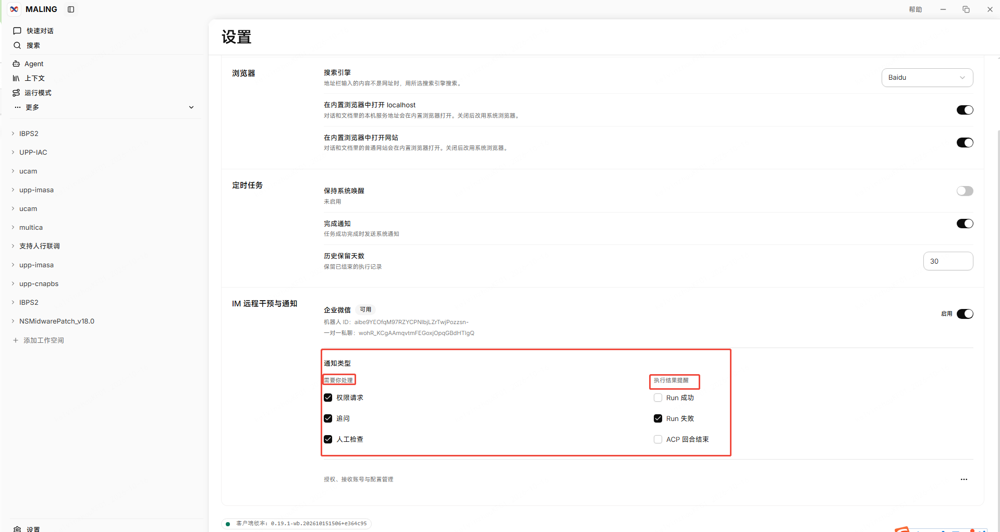

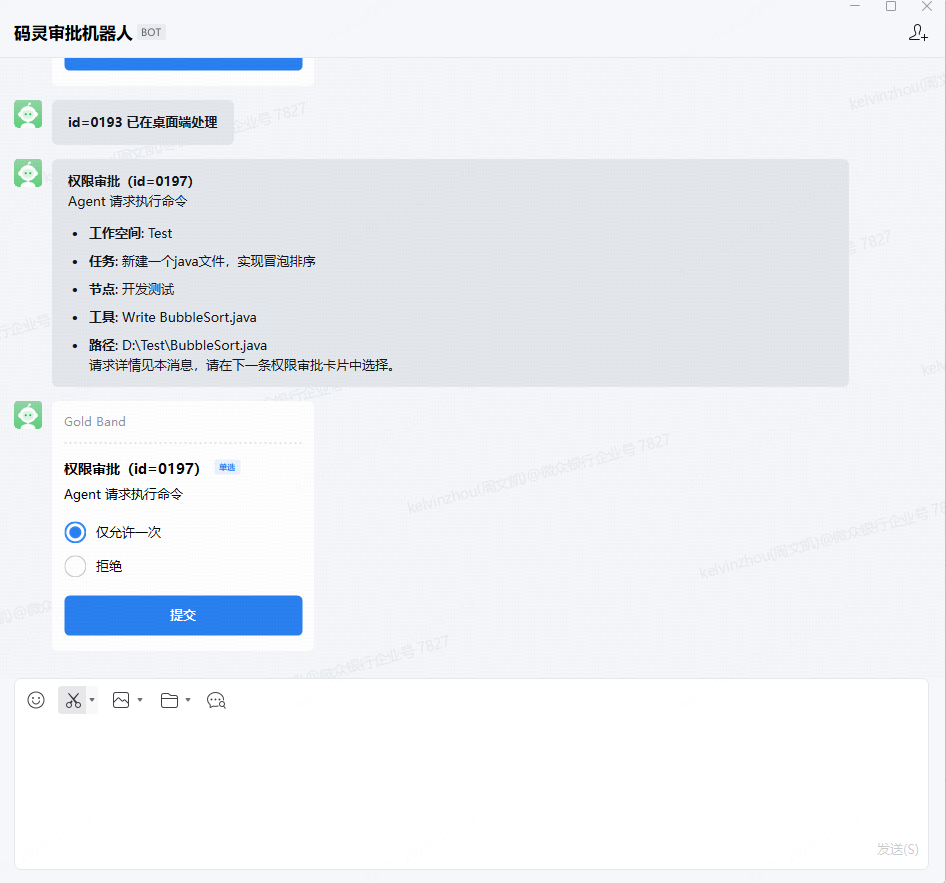

</details>

#### 4.4.3 选择需要的通知

展开对应渠道，在「通知类型」中分别选择：

| 分组 | 界面选项 | 收到后怎么处理 |
| --- | --- | --- |
| 需要你处理 | 权限请求 | 先审阅操作内容，再选择卡片提供的允许或拒绝选项并提交 |
| 需要你处理 | 追问 | 回答 Agent 的问题；飞书支持能力范围内的单选、多选、文本和“其他”答案 |
| 需要你处理 | 人工检查 | 审阅产物和说明后判定「成功」或「失败」，不是确认收到了消息 |
| 执行结果提醒 | Run 成功 | 查看一次运行的成功结果；通知本身只读 |
| 执行结果提醒 | Run 失败 | 查看失败原因，必要时回客户端排障；通知不会自动替你重跑 |
| 执行结果提醒 | ACP 回合结束 | 查看 Agent 一轮回复结束的提醒，不等于整个工作流或需求已完成 |

建议先开启实际需要的三类干预；想知道运行结果时再勾选 Run 成功 / 失败，想收到每轮 Agent 回复结束的提醒时再选 ACP 回合结束。**修改后点击「保存通知设置」才生效**；不想保留本次勾选时点「放弃修改」。

#### 4.4.4 收到手机卡片后怎么操作

1. 核对工作空间、任务和当前请求；企业微信可能先发送详情，再发送带相同 `id` 编号的操作卡片，应配对阅读。
2. 权限请求先阅读命令、路径等信息，再选择允许 / 拒绝；追问先填写全部必答项，再提交；人工检查先审阅结果，再选择成功 / 失败。
3. 提交后等卡片结果和桌面状态更新。飞书已处理卡片会保留**实际接受的答案**并禁用控件；显示“处理中”时先等结果，不连续提交。
4. 桌面端、企微、飞书任一端处理成功后，其他已有卡片的渠道同步处理结果。飞书可以更新原卡；企微跨端处理可能另发结果消息。另一端先处理成功时，不能再用旧卡片改写答案。

**能力差异**：企业微信不支持自由文本和“其他”输入，多题单选最多 3 题；飞书支持更多表单类型，也有题数、选项数和字数限制。某个请求无法安全呈现在渠道卡片中时，回桌面端处理，不能把“没收到卡片”一律当作连接失败。详见 [Q24](#faq-im-forms)。

**使用条件**：每个渠道只绑定一个机器人、一个接收账号和一个一对一私聊；**一个机器人只连接一台设备**。接入是当前客户端的全局设置，核对卡片里的任务后再操作。客户端应保持运行，电脑和所需网络应可用；退出、关机、休眠或断网期间不能保证实时收发。

在私聊里发送“继续”“帮我新建任务”等自然语言，**不会启动、停止、重跑或编辑本机任务**；群聊也不支持。普通私聊消息用于绑定，不是完整的远程对话入口。

**自行验证一次**：在可安全试用的会话中，让 Agent 通过其支持的提问能力发起一次待答问题，在手机卡片作答，再确认桌面卡片已显示相同结果且任务继续。Agent 没有产生结构化提问卡片时，普通文字问句不一定会触发 IM 干预。

#### 4.4.5 重连、暂停、重新授权与更换应用

| 你要做什么 | 在对应渠道里操作 | 后续检查 |
| --- | --- | --- |
| 暂时停止该渠道收发 | 关闭「启用」 | 状态为「已暂停」，通知偏好保留；恢复时重新开启 |
| 网络恢复后连接已停止 | 按状态区提示点「重新连接」 | 等状态恢复；「正在重连」时先等待自动恢复 |
| 飞书重新绑定当前授权账号 | 「配置管理 → 重新绑定接收账号」 | 已有绑定时显示该入口；清除旧绑定后，由**原扫码授权账号**再次主动私聊，这不会更换授权人 |
| 飞书更换授权账号或补齐缺少的权限 | 「配置管理 → 重新授权」或状态区「重新授权」 | 重新扫码授权后，用本次授权账号再次私聊绑定 |
| 飞书改用另一个机器人 / App ID | 「配置管理 → 更换飞书应用」 | 在授权页面选择已有应用或新建应用；**完成授权会替换应用并清除旧私聊绑定**，须给新机器人发消息重新绑定 |
| 企业微信更换接收账号 | 「配置管理 → 更换接收账号」 | 已有绑定时显示该入口；按确认提示清除旧绑定，再由新接收账号主动私聊绑定 |
| 彻底移除本机接入 | 「配置管理 → 删除配置」 | 连接停用、待投递消息停止发送；再次使用需重新扫码接入 |

收不到消息见 [Q18](#faq-im)，显示「连接被占用」见 [Q23](#faq-im-conflict)，升级后旧卡失效见 [Q26](#faq-im-upgrade)。

### 4.5 个人数据分析

**入口**：顶部「帮助 → 个人数据分析」。选择需要查看的时间范围，阅读本地使用统计；需要进一步分析时，再按页面提供的入口使用 Agent。

<details>
<summary>查看个人数据分析入口</summary>

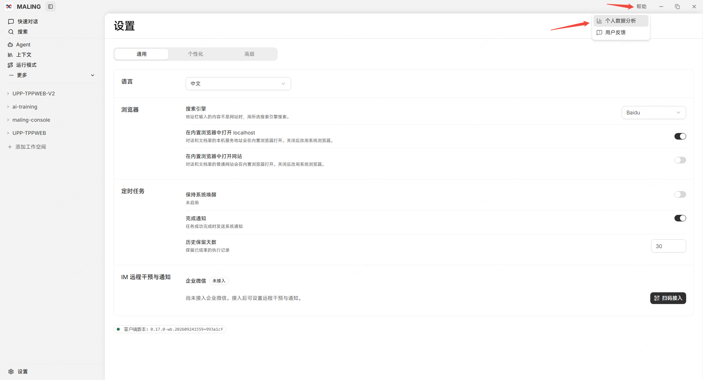

</details>

### 4.6 主题、字号、头像与壁纸

**入口**：设置 → 个性化。

| 想调整什么 | 操作 |
| --- | --- |
| 主题、明暗模式 | 选择主题，并设置跟随系统、浅色或深色 |
| 界面大小、字体 | 调整界面缩放；界面 UI 与编辑器的字体、字号可分别配置 |
| 个人或 Agent 头像 | 在头像区域选择对象，上传并按提示裁剪 |
| 壁纸 | 选择或导入壁纸，调整可见度；需要时恢复主题壁纸 |

<details>
<summary>查看个性化、头像和壁纸示例</summary>

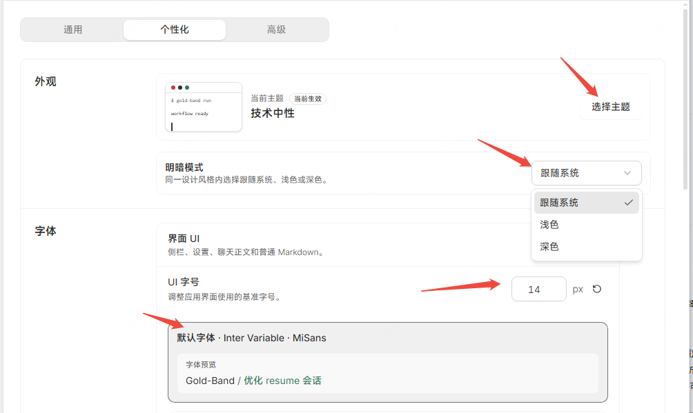

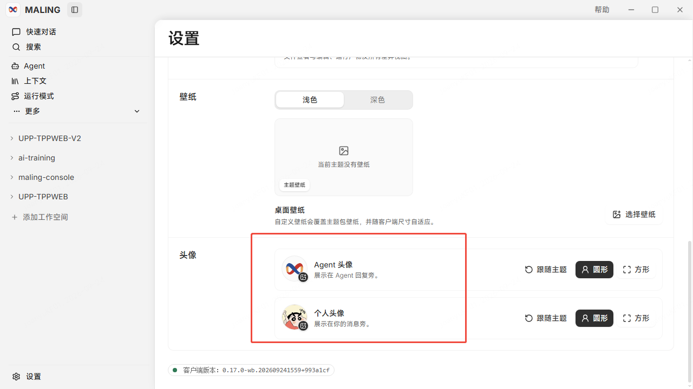

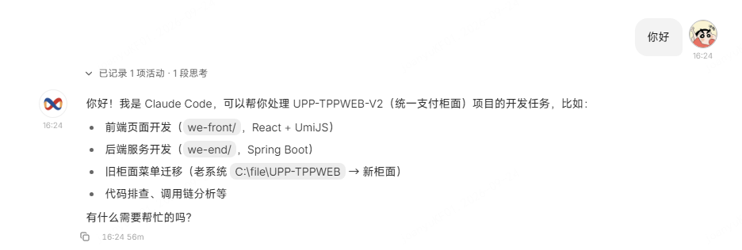

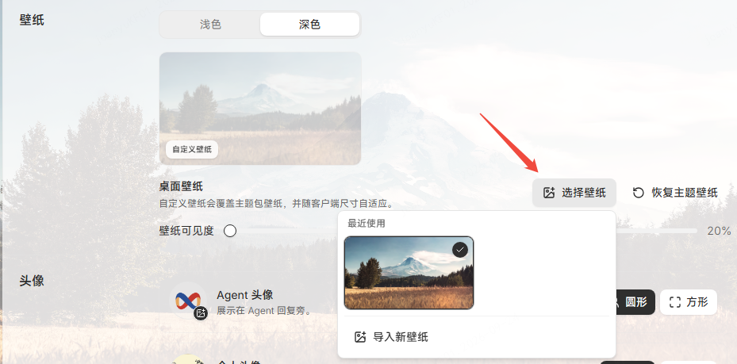

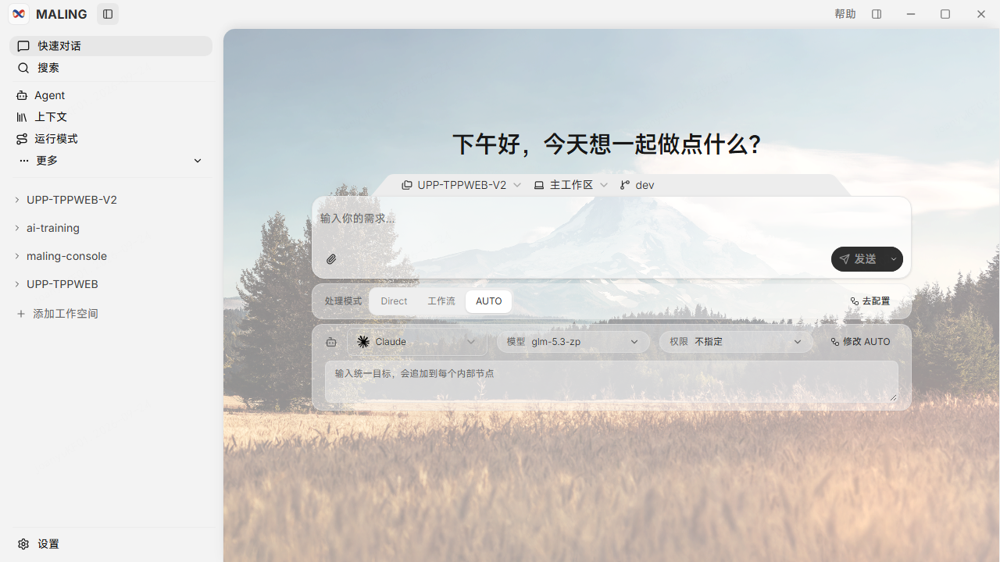

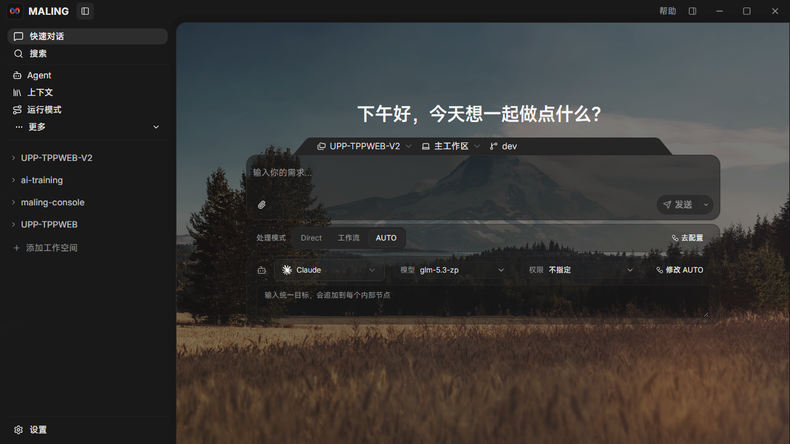

</details>

<a id="find-conversations"></a>

### 4.7 查找最近会话与跨项目会话

- 在侧栏「最近会话」中按活动时间找到近期对话，点击后打开对应工作空间的会话。
- 按 `Ctrl+F`（macOS 为 `Cmd+F`）打开会话搜索并输入关键词，选择结果进入会话；按 `Esc` 关闭搜索。代码编辑器有焦点时，会优先进行文件内查找。
- 在具体工作空间下查找较早会话时，向下滚动继续加载列表。首批只展示部分会话，不表示历史已被删除。

找不到历史时先核对工作空间，再按 [Q16](#faq-history) 检查版本、渠道和用户数据目录。

<a id="advanced-use"></a>

## 5. 进阶配置

### 5.1 先分清角色、MCP 和 SKILL

统一入口是侧边栏「上下文」。

| 能力 | 用途 | 例子 |
| --- | --- | --- |
| 角色（Profile） | 规定某个节点的职责、目标和约束 | 开发、测试、审查、验收 |
| MCP | 给 Agent 接入工具和外部服务 | 代码搜索、调用链分析 |
| SKILL | 提供可复用的技能说明和配套资源 | 某类项目的分析或测试流程 |

### 5.2 配置 MCP

**入口**：上下文 → MCP。

1. 按服务说明选择本地 Stdio、远程 HTTP 或远程 SSE，填写对应配置。
2. 保存后检查服务诊断结果；需要授权时完成授权，再重新检查。
3. 确认服务已启用，并查看所选 Agent 是否支持该传输方式。
4. 开始新的会话验证工具是否可用。不要把配置页保存成功等同于 Agent 已调用成功。

内置 MCP 可查看说明、诊断、查看工具和启停；不能像自定义服务一样编辑或删除。故障处理见 [Q19](#faq-context)。

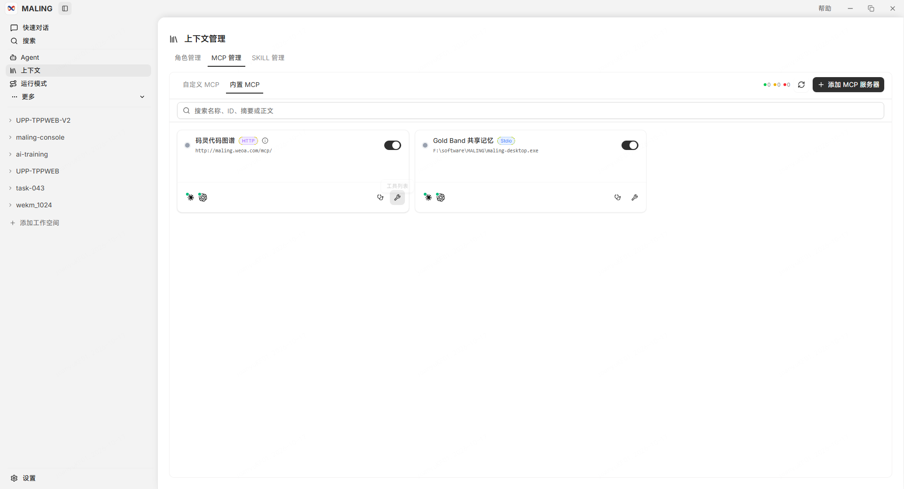

### 5.3 管理和同步 SKILL

**入口**：上下文 → SKILL。

1. 确认作用域：全局 SKILL 面向当前用户，项目 SKILL 面向当前工作空间。
2. 新建、查看或编辑需要的 `SKILL.md`；引入远程 SKILL 前先阅读内容。
3. 在同步选项中选择目标 Agent，确认页面显示同步结果。
4. 用目标 Agent 的新会话验证是否能发现和使用。名称相同不代表已同步到所有 Agent。

已有同名原生 SKILL 时会发生冲突，先核对真实目录和目标 Agent，不要直接覆盖。连接 Multica 后，可在全局 SKILL 页点「同步远程 SKILL」，选择远程工作空间和 SKILL 拉取；同步包含 `SKILL.md` 及配套脚本、说明等文件。**选择覆盖会替换整个本地 SKILL 目录，远程没有的本地文件也会删除**，先保存需要保留的修改。

<details>
<summary>查看本地 SKILL 和远程 SKILL 操作</summary>

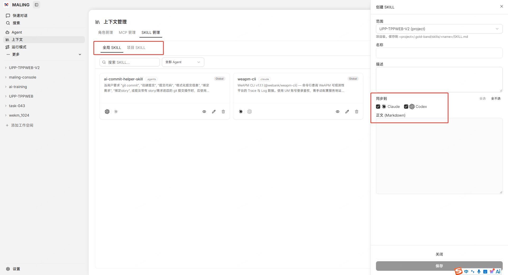

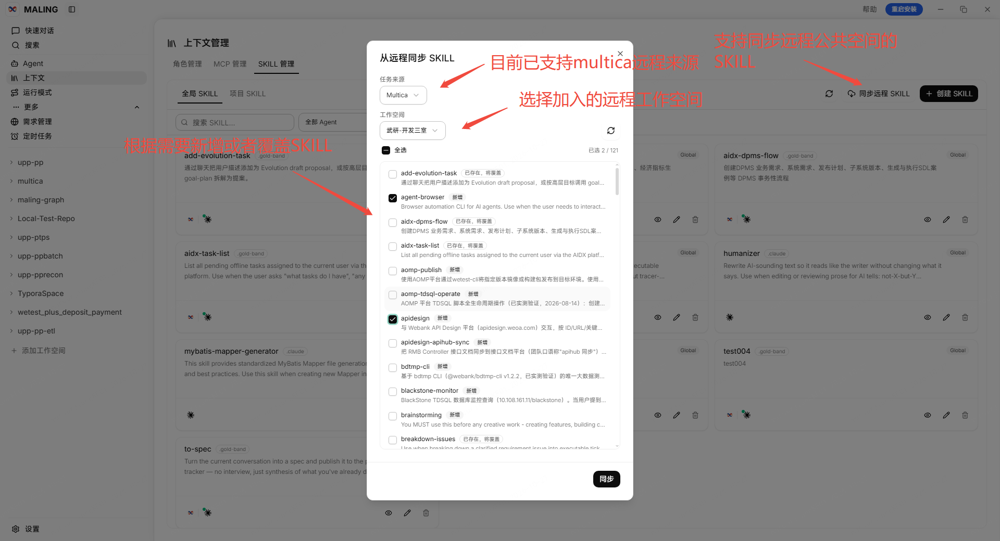

</details>

### 5.4 新增和导入角色

**入口**：上下文 → 角色。

内置角色只读；需要定制时「另存为新角色」后编辑。也可以「新增角色」、选择一个或多个 Markdown 文件导入，或选择文件夹批量导入；每批最多处理 5000 个文件。导入后检查逐项结果，失败文件不会使整批导入失效。

创建好角色后，还要在相应工作流节点中选择它。角色不会替你改变 Agent 的原生权限模式；例如规划角色即使拥有更高工具权限，也仍受规划职责约束。

WB 行内渠道提供只读的 WeAPM 内置角色，用于查询 Trace / Log；需要内部服务、相应网络和 `weapm` CLI。没有这些前置条件时，角色出现在列表中也不代表可以成功查询。

<details>
<summary>查看角色列表和新增入口</summary>

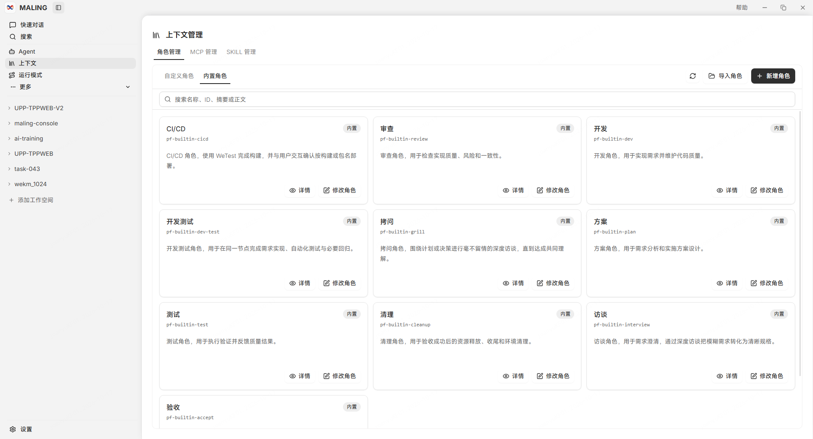

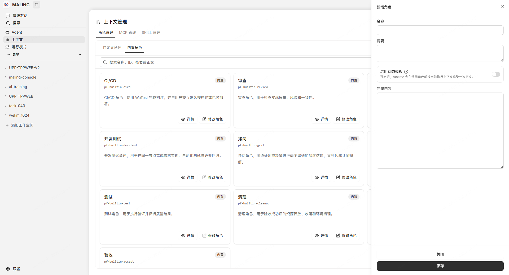

</details>

### 5.5 执行 Multica 远程任务

**入口**：更多 → 需求管理。

1. 使用页面提供的连接入口，完成 Multica 服务地址和账号连接；行内与自建服务使用各自的地址。
2. 选择有权限的远程工作空间，并配置对应本地项目。
3. 按开发 / 测试类型筛选或按任务名搜索。测试任务显示「已就绪」时可优先处理；上游开发尚未完成时，先确认是否具备测试条件。
4. 点击「执行」，需求和上游交付说明会带入会话；选择 Direct、工作流或 AUTO，核对本地项目与输入后，**点击「发送」才正式领取并执行**。
5. 上游说明尚未就绪时，在会话处理卡中选择继续等待、手动提供信息或跳过本次拉取。远程附件下载失败时检查缺失内容，必要时补充材料。
6. 执行后检查交付说明和远程任务状态；Direct 的一轮回复结束不等于远程需求已完成。终态任务确实需要再跑时，选择「重新执行」后重新核对任务。

**成功标志**：可以看到有权限的任务，并将所选任务在正确的本地工作空间执行。看不到空间或任务时，先确认账号权限、服务地址和筛选条件。

<details>
<summary>查看 Multica 连接和任务看板</summary>

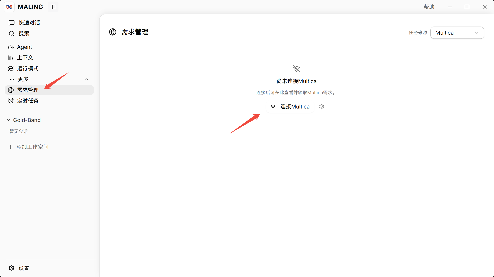

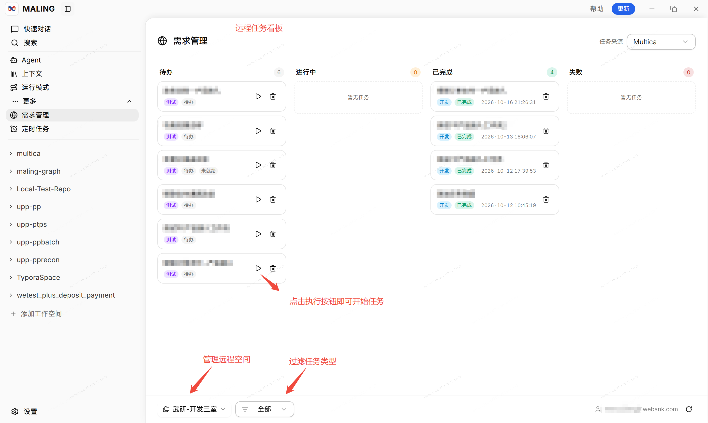

</details>

### 5.6 使用码灵代码图谱

**前置条件**：当前渠道提供「码灵代码图谱」内置 MCP，且项目已在对应代码图谱控制台接入。

1. 到「上下文 → MCP」找到「码灵代码图谱」，按服务说明打开控制台并接入项目。
2. 确认服务启用、诊断正常，当前 Agent 支持其连接方式。
3. 在 Agent 会话中提出代码搜索、调用链或节点详情问题，并检查是否出现对应工具调用和结果。

示例：“请用代码图谱查找登录校验的入口和调用链，并给出相关文件。”如果项目尚未接入、无权限或服务不可达，先处理这些条件；仅在客户端启用 MCP 不会自动完成项目接入。

<a id="troubleshooting"></a>

## 6. 常见问题与排障

### 6.1 先找到与你相同的现象

| 现象或搜索词 | 对应问答 |
| --- | --- |
| npm 报错、npx 下载失败、VDI 镜像源 | [Q01](#faq-npm) |
| 客户端打不开、macOS 无法验证开发者 | [Q02](#faq-open) |
| 检查更新失败、找不到更新 | [Q03](#faq-update) |
| 没有可用 Agent、环境诊断失败 | [Q04](#faq-agent) |
| 模型 / 权限 / 思考强度下拉为空 | [Q05](#faq-model) |
| 已登录，仍提示需要授权 | [Q06](#faq-auth) |
| `_npx`、`ENOENT`、`package.json` 缺失 | [Q07](#faq-npx-cache) |
| 发送按钮灰色 | [Q08](#faq-send) |
| 一直处理中、没有输出、等待权限 | [Q09](#faq-no-output) |
| 附件太大、路径过长、找不到文件 | [Q10](#faq-attachment) |
| 停止后不推进、继续和恢复怎么选 | [Q11](#faq-continue) |
| 工作流保存失败、多个入口、节点不可达 | [Q12](#faq-workflow-validation) |
| AUTO 不结束、反复运行、token 太多 | [Q13](#faq-auto) |
| Git 不可用、提交按钮灰色、冲突 | [Q14](#faq-git) |
| 新工作树创建失败、工作树已收回 | [Q15](#faq-worktree) |
| 会话找不到、切换项目后历史不见了 | [Q16](#faq-history) |
| 定时任务到点没跑、已错过、已跳过 | [Q17](#faq-schedule) |
| 企微 / 飞书没消息、通知不来、等待绑定 | [Q18](#faq-im) |
| MCP 不可用、SKILL 没生效、角色不能改 | [Q19](#faq-context) |
| 浏览器重新登录、HTML 显示源码、图片不显示 | [Q20](#faq-browser) |
| 版本入口不同、找不到用户反馈 | [Q21](#faq-channel) |
| 飞书扫码失败、缺少权限、授权后仍等待绑定 | [Q22](#faq-feishu-onboarding) |
| IM 连接被占用、多台电脑共用机器人 | [Q23](#faq-im-conflict) |
| 飞书 / 企微没有提问卡片、文本或“其他”不能填 | [Q24](#faq-im-forms) |
| 待发送不自动发、草稿取不出、立即发送会打断吗 | [Q25](#faq-drafts-queue) |
| 升级后 IM 旧卡失效、更换应用后通知消失 | [Q26](#faq-im-upgrade) |

<a id="faq-npm"></a>

### Q01：npm 安装或 Agent 诊断报错，怎么处理？

先看错误内容，区分运行环境、下载网络、包权限和缓存；“npm 报错”不能统一归因于版本低。

1. 在 PowerShell 查看当前工具链：

   ```powershell
   node --version
   npm --version
   npx --version
   Get-Command node, npm, npx
   npm config get registry
   ```

2. 如果命令不存在、版本不满足或路径混用了多套 Node.js，按首次启动引导提供的安装指引准备配套工具链。重新打开客户端，再点击「重新检测」。
3. 如果是超时、连接失败或包下载失败，检查当前网络能否访问实际 registry、登录及模型服务。**仅行内 VDI 用户**，确认组织要求使用该镜像时，可先记录上一步的原 registry，再执行：

   ```powershell
   npm config set registry http://wnpm.weoa.com:8001
   ```

   这是持久配置，会影响之后的 npm/npx 下载；离开该网络或切换用途时，恢复之前记录的 registry。不要给外网用户直接套用内网地址。
4. `401` / `403` / 包不存在，需要核对镜像同步与访问权限；`ENOENT` 且明确涉及 `_npx/.../package.json`，转到 [Q07](#faq-npx-cache)。

**确认修复**：原失败命令或同一个 Agent 的环境诊断通过。仍失败时提供完整错误、工具版本和当前 registry，隐藏凭据。

<a id="faq-open"></a>

### Q02：安装后客户端打不开，或 macOS 提示无法验证开发者？

- **Windows / VDI**：记录安装器或系统显示的完整提示，核对安装包来源、系统架构和组织安装限制；下载中断时重新下载同一渠道安装包。
- **macOS**：按 [macOS 安装与排障指南](guide/macos-install.zh-CN.md) 核对包来源、完整性及 Gatekeeper 处理方式，不从一句“应用损坏”就判断文件必然损坏。
- **打开后白屏或闪退**：记录发生时间、版本和操作系统，保留现场后按[第 7 节](#feedback)收集日志。

**确认修复**：客户端能进入首次启动引导或会话主页。仍失败时附系统提示或截图；不要先删配置或会话数据。

<a id="faq-update"></a>

### Q03：检查更新失败，或明明有新版本却没提示？

到「设置 → 高级 → 更新」查看当前版本、更新状态和实际更新地址。确认安装包与更新源属于同一渠道；行内源需要对应网络。使用过覆盖地址时，确认是否还需要它，必要时选择「恢复内置地址」后重新检查。

仍失败可从同一渠道下载新安装包覆盖安装，或提供更新错误、版本和发生时间反馈。不要随意换到另一渠道更新源。

<a id="faq-agent"></a>

### Q04：没有可用 Agent，或“环境诊断”失败？

打开侧边栏「Agent」，确认 Agent 已保存，再点「环境诊断」，展开失败原因：

- 找不到命令：完成对应 CLI 安装，检查当前用户的 PATH；在引导提供路径修复入口时选择正确可执行文件。
- npm/npx 下载或环境错误：按 [Q01](#faq-npm) 处理。
- 登录、授权或模型访问失败：按 [Q06](#faq-auth) 处理。
- 已明确识别的 npx 安装缓存缺失：按 [Q07](#faq-npx-cache) 处理。

安装或登录完成后，回到**同一个 Agent**重新诊断。内置启动参数由客户端维护，不要用新建多个同名 Agent 掩盖原错误。

**确认修复**：该 Agent 诊断通过，可以在对应会话或节点中选择。仍失败时提供 Agent 名称和完整诊断原因。

<a id="faq-model"></a>

### Q05：模型、权限或思考强度下拉为空，怎么办？

先到「Agent」确认当前 Agent 诊断通过。选定模型后，如果模型菜单显示「尚未获取此模型的配置」，可以点击同一菜单中的「获取模型配置」。这是读取能力选项，不会替你执行一次任务。

不同 Agent、模型提供的选项不同，没有某个思考强度或权限选项不一定是故障；以实际能力返回为准。切换 Agent / 模型后重新确认设置；遇到“已回滚为不指定”提示时，按当前可用目录重新选择。

**确认修复**：能选择当前 Agent 实际支持的配置并正常发起会话。获取配置失败时保留错误，不要把另一个模型的选项当作当前模型已支持。

<a id="faq-auth"></a>

### Q06：已经登录 Agent，为什么还提示需要授权？

码灵、Agent、MCP 和企业服务的登录状态各自独立。先看失败的是哪一层：Agent 需要在该 CLI / 供应商流程完成登录，MCP 需要在服务配置里完成授权，Multica 则需要有效连接及空间权限。

使用与客户端相同的系统用户完成授权；CodeBuddy 行内登录按[第 2.2 节](#quick-start)。授权完成后重新诊断，并**手动重新发送**原消息，鉴权失败的消息不会自动替你重发。

仍失败时提供失败服务、错误码和登录方式，勿发送 Token、Cookie 或登录二维码。

<a id="faq-npx-cache"></a>

### Q07：诊断提示 `_npx` 中缺少 `package.json`，要清空缓存吗？

优先使用「Agent」异常卡片上的「修复缓存」入口。它只在客户端识别到对应缺失路径时提供；预览后核对影响，再选择「清理并重新检测」。

这会重新下载相关适配器，正在使用同一缓存的 Agent 可能中断，先停止相关任务。不要直接清空整个 npm 缓存或删除全部 Agent 数据。

**确认修复**：区分“缓存清理成功”和“Agent 诊断通过”；若仍失败，查看新诊断原因继续处理。入口未出现时保留原错误，回到 [Q01](#faq-npm) 判断其他原因。

<a id="faq-send"></a>

### Q08：发送或创建定时任务按钮是灰色的？

检查输入正文是否有效、工作空间是否存在、当前模式配置是否完整。Direct 需要可用 Agent；工作流需要有效模板和节点配置；定时任务还需要有效计划时间。查看输入区的具体校验提示，修正后再提交。

如果正在发送或创建，等待当前操作完成。保留异常提示，避免连续点击或重复创建。

<a id="faq-no-output"></a>

### Q09：一直“处理中”、没有输出，或者任务像卡住了？

先看当前会话的状态和最后一条事件，再决定下一步：

| 当前现象 | 处理 |
| --- | --- |
| 等待权限 | 审阅操作，在对应权限卡中允许或拒绝 |
| 等待用户输入 | 在提问卡中作答并提交 |
| 等待人工判定 | 审阅结果后，在人工 check 卡中选择成功或失败 |
| 正在压缩上下文 | 等 Agent 完成；可用时查看压缩摘要，不因暂时无正文就重复发任务 |
| 已停止 / 暂停 | Direct 可以继续对话；工作流 / AUTO 按 [Q11](#faq-continue) 恢复 |
| 错误阻塞 | 先处理显示的配置、文件或授权原因，再按页面动作恢复 |
| 没有以上提示且持续无进展 | 查看「原始帧」和最近错误，保留发生时间；需要中止时先用停止入口 |

**确认修复**：当前状态继续推进或得到明确错误。仍无法判断时反馈模式、Agent、最后状态、持续时间和错误文本，而不只写“卡了”。

<a id="faq-attachment"></a>

### Q10：附件发送失败、文件太大、路径过长或文件不存在？

先检查当前附件数量和体积：最多 10 个，单文件不超过 25 MB；当前输入区在总计超过 50 MB 时会提示超限。超限时减少文件或拆分发送；项目内已有文件可以优先使用「引用到对话」。

文件不存在时确认没有被移动、删除或断开挂载。路径过长时缩短文件名和源路径；如果错误路径位于客户端数据目录，新建会话后重新添加并发送，不手动改运行目录。

**确认修复**：同一个文件可以添加和发送。仍失败时提供错误路径类型、文件名长度和大小；路径中的用户或项目名称可脱敏。

<a id="faq-continue"></a>

### Q11：工作流停止后发消息不推进，“继续”和“恢复”该选哪个？

工作流 / AUTO 停止后的普通追问可以继续对话，但**不会推进工作流节点**。按当前页面提供的动作选择：

| 动作 | 使用场景 |
| --- | --- |
| 继续工作流 | 当前节点未完成，需要继续它的执行 |
| 恢复工作流 | 当前节点已完成，完成结果到下一步跳转之间中断；不重新执行已完成节点 |
| 继续并发送 | 有补充说明，同时需要恢复执行 |
| 重跑该任务 | 明确要重新开始一次运行，历史运行保留 |

等待权限、用户输入或人工判定时，先处理对应卡片；错误阻塞时先解决原因。Direct 没有工作流继续动作，停止后直接继续普通对话。

**确认修复**：当前节点继续产生执行结果，或流程进入下一节点。不要仅用 Agent 回复“已继续”判断运行时已推进。

<a id="faq-workflow-validation"></a>

### Q12：工作流保存失败，提示多个入口、节点不可达或 Agent 不可用？

在画布的问题摘要中点击对应问题，逐项修正：入口必须唯一、节点从入口可达、执行节点配置完整、连线和结果判定合法。同一来源节点的同一种结果只能有一条出边。

节点 Agent 不可用时，到「Agent」重新诊断后再选；启用失败分支时，检查该节点是否配置了相应结果判定。不要为了消除提示随意把节点接到结束，而改变实际执行目标。

**确认修复**：模板保存校验通过，启动时同样通过校验。

<a id="faq-auto"></a>

### Q13：AUTO 反复开新一轮、一直不结束或 token 消耗太高？

先检查当前任务是否仍有活动节点、等待用户处理，或者在验收失败后修复。再核对需求是否有可判断的完成标准，动态节点、并行、fanout、深度与轮次等上限是否适合当前任务。

目标过宽时先停止，明确范围和验收条件，再通过当前运行支持的配置与继续入口处理；如果需要重新设计流程，确认后重跑。小任务可以改用 Direct，固定阶段任务可以改用工作流。正在运行的任务不会因为你修改了默认模板就自动变化。

**确认修复**：有明确的下一步、剩余范围和结束条件；不要把“设得越大”当成更容易完成。

<a id="faq-git"></a>

### Q14：源码管理不可用，或暂存、提交、切分支按钮变灰？

先看页面提示：Git 是否安装且满足版本要求、当前目录是否为仓库、是否有首次提交、是否处于 Merge/Rebase 或冲突状态。同一工作空间有 Git 写操作进行时，其他写操作会暂时禁用。

按提示安装并「重新检测」，或审阅后初始化仓库、暂存并创建首次提交。已有冲突时先处理冲突，不通过删除 Git 文件或强制切分支绕过。

**确认修复**：当前仓库状态明确，相关操作可用；仍失败时反馈操作名和 Git 返回的具体原因。

<a id="faq-worktree"></a>

### Q15：新工作树创建失败，或提示“会话工作树已收回”？

创建失败时检查 Git 前置条件、仓库状态、目标分支是否被其他 worktree 占用。非 Git 项目可以先在主工作区使用 Direct；需要工作树时再准备仓库。

已收回或路径不存在的会话工作树不会自动改成主项目目录。页面上的「浏览主工作区」只切换浏览位置；需要继续开发时，先确认原分支和改动位置，再在有效工作位置发起任务。

不要把另一个目录的文件当作原任务成果；仍不确定时，保留原路径和 Git 状态后反馈。

<a id="faq-history"></a>

### Q16：切换工作空间后，之前的会话或文件为什么不见了？

会话按工作空间组织，先切回原项目并在侧栏或搜索中查找；文件和源码管理还会跟随所选会话的主目录或 worktree。

如果升级后全部配置都像新安装，先核对是否切换了系统用户、发行渠道或用户数据目录。行内 MALING 与开源 Gold Band 的默认数据目录不同，见[第 7.2 节](#data-directories)。不要靠反复添加同一路径或复制状态文件恢复。

<a id="faq-schedule"></a>

### Q17：定时任务到点没跑，显示“已错过”“已跳过”或“需要处理”？

打开「更多 → 定时任务」的对应详情，按顺序检查：任务是否启用、日期/时间/时区是否正确、客户端和电脑是否在当时可运行、Agent 和网络是否可用、执行历史的具体原因。

- **已错过**：检查计划时间客户端是否未运行或电脑不可用。
- **已跳过**：查看是否受并发、队列或重复执行保护影响，以记录原因判断。
- **需要处理 / 失败**：打开对应错误或运行记录，处理配置、授权或任务执行问题。

「保持系统唤醒」不能在关机或退出客户端后触发任务。可用「立即执行」检查运行链路，但这会真实执行任务；先确认不会重复提交、部署或产生其他重复副作用。

**确认修复**：下次计划正确，测试运行有记录且结果符合预期。

<a id="faq-im"></a>

### Q18：企业微信 / 飞书收不到通知、一直“等待绑定”，或卡片点了没反应？

到「设置 → 通用 → IM 远程干预与通知」，展开**实际使用的渠道**，先看状态再处理：

| 渠道状态 | 处理 |
| --- | --- |
| 未接入 | 按 [4.4](#im-remote) 扫码授权，再完成一对一私聊绑定 |
| 等待绑定 | 给本次授权的机器人发私聊；飞书必须由扫码账号发送，详见 [Q22](#faq-feishu-onboarding) |
| 已暂停 | 打开该渠道「启用」开关 |
| 连接中 / 正在重连 | 保持客户端和网络可用，等连接结果 |
| 连接失败 | 检查网络与显示的错误，按提示「重新连接」 |
| 需要重新授权 | 重新扫码；飞书缺少权限时见 [Q22](#faq-feishu-onboarding) |
| 连接被占用 | 先关闭其他设备的同一机器人连接，再重新连接，见 [Q23](#faq-im-conflict) |
| 可用 | 继续检查下方通知偏好与任务是否产生了对应事件 |

状态已「可用」仍没消息时，确认**该渠道**的相应通知类型已勾选并「保存通知设置」，接收账号正确，任务确实产生了新事件。ACP 回合结束与 Run 成功是两个独立选项；普通聊天文字也不一定产生结构化追问卡片。

卡片不能操作时，先在桌面检查请求是否已处理、过期或任务已停止；字段缺失 / 题型不支持见 [Q24](#faq-im-forms)，旧版本卡片失效见 [Q26](#faq-im-upgrade)。

**确认修复**：一次新的受支持干预或通知能送达；操作后桌面显示相同结果。反馈时提供渠道、状态、通知选项、发生时间和错误码，不能只凭“连接在线”判断绑定完成。

<a id="faq-context"></a>

### Q19：MCP 连不上、SKILL 没生效，或内置角色不能修改？

三种资源分开检查：

- **MCP**：上下文 → MCP，核对启用状态、服务诊断、授权、地址/命令，以及当前 Agent 支持的传输方式。保存成功不等于工具调用成功。
- **SKILL**：核对当前工作空间、全局/项目作用域、目标 Agent 同步状态和同名目录冲突。修改后用目标 Agent 的新会话验证。
- **角色**：内置角色只读，需要另存为新角色后编辑，并在目标节点选择。创建角色不会自动替换所有节点角色。

仍失败时提供资源类型、名称、作用域、目标 Agent 和错误，不只写“上下文不生效”。

<a id="faq-browser"></a>

### Q20：内置浏览器需要重新登录、HTML 显示源码，或网络图片不显示？

- **登录态**：内置浏览器独立于系统浏览器，需要在其中登录；不会自动导入 Chrome/Edge 的 Cookie。
- **HTML 源码**：从文件树打开 HTML 默认先显示源码，选择内容区的「在浏览器中打开」查看页面。
- **外跳系统浏览器**：在「设置 → 通用 → 浏览器」检查网站和 localhost 的打开偏好。
- **Markdown 网络图片**：默认需要确认加载；在图片占位处点击「加载」，受信任域名可在「设置 → 高级 → 受信任的图片域名」中管理。

页面仍打不开时，分别核对网页地址、网络或本机服务是否启动；不要用取消图片限制来处理服务不可达。

<a id="faq-channel"></a>

### Q21：为什么别人有某个入口，我这里没有，例如“用户反馈”或“代码图谱”？

先在「设置」核对客户端版本和发行渠道，再检查所在页面及当前工作空间。行内 MALING 和开源 Gold Band 的渠道集成有差异：用户反馈、内置代码图谱和预设服务地址不一定相同。

不要为获得一个入口随意替换更新源或复制其他人的配置。看不到用户反馈时，用组织指定的反馈渠道或项目 Issue，并按下面的清单准备信息。

<a id="faq-feishu-onboarding"></a>

### Q22：飞书扫码失败、提示缺少权限，或授权成功后仍“等待绑定”？

**扫码阶段失败**：二维码过期 / 授权超时，点「重新生成」后重新扫码；无法连接授权服务时，先检查本机网络。看到授权被拒绝时，核对飞书账号、组织和授权页面提示，不通过反复新建本地配置解决。

**提示 `IM_SCOPE_MISSING`（应用缺少必需权限）**：选择「重新授权」，核对四项说明并完成授权。当前流程除收发消息和更新卡片外，还会申请读取姓名用于显示接收账号；按当前界面完成，不套用旧版“三项权限”说明。

**授权完成但仍等待绑定**，逐项检查：

1. 用的是否是**刚才扫码的同一个飞书账号**；换账号或由同事代发不能绑定。
2. 是否进入**本次 App ID 对应机器人的一对一私聊**；不是群聊、旧机器人或给小助手的其他会话。
3. 是否在本次授权后主动发送过一条新文字消息；只打开机器人窗口或看到授权成功不够。
4. 是否刚做过「重新授权」「更换飞书应用」或清除绑定；这些操作后需要再次私聊。只想重绑当前授权账号用「重新绑定接收账号」；更换授权人用「重新授权」。

**确认修复**：状态为「可用」且接收账号正确。若显示「已绑定一对一私聊」但没有姓名，不能仅凭姓名未显示判断失败；结合状态和一次新通知确认。仍失败时反馈阶段、错误码和应用是否更换，勿提供 App Secret 或授权二维码。

<a id="faq-im-conflict"></a>

### Q23：显示“连接被占用”，一个机器人能在两台电脑上使用吗？

当前按**一个机器人连接一台设备**使用。先关闭另一台电脑、VDI 或另一处客户端的同一机器人连接，再回当前渠道点「重新连接」，等状态恢复「可用」；不要让两处持续互相重连。

需要同时在两台电脑使用时，为各设备分别接入不同机器人；飞书可通过「配置管理 → 更换飞书应用」选择另一个应用或创建新应用，然后给新机器人发私聊重新绑定。它不是跨设备接管或消息中继。

**确认修复**：当前设备稳定可用，新请求在预期机器人私聊中收到并能处理。

<a id="faq-im-forms"></a>

### Q24：为什么飞书 / 企微没有收到提问卡片，或手机不能填文本、“其他”？

先确认当前请求在桌面端确实是**待处理的结构化追问**，再按 [Q18](#faq-im) 检查渠道与通知开关。Agent 在普通回复中写一句问题，不等于发起了受支持的干预请求。

| 情况 | 当前处理方式 |
| --- | --- |
| 企业微信需要自由文本或“其他” | 企业微信不支持该输入；单选可能仅呈现固定选项，需要自定义答案时回桌面处理 |
| 企业微信有多题或多选 | 多题单选最多 3 题；多选仅支持单题且不带“其他”。超出范围的表单不会整单发到该渠道 |
| 飞书需要填表 | 支持能力范围内的单选、多选、单行 / 多行和“其他”；按卡片要求填写全部必答项后提交 |
| 飞书题目、选项或输入过长 | 卡片也有限制；以界面校验为准，需要完整作答时回桌面处理 |
| 卡片已处理、过期或任务停止 | 查看桌面当前状态，不能继续用旧卡片提交新答案 |

不支持的完整表单可能只出现在桌面端；客户端不会为了发送手机卡片而随意拆题。不要只因缺一张卡片就删除渠道配置。

**确认修复**：有效答案被当前请求接受，任务状态继续推进。两端同时操作时以先被接受的结果为准，后到答案不能覆盖它。

<a id="faq-drafts-queue"></a>

### Q25：待发送队列为什么不自动发？草稿取不出来，或“立即发送”会打断吗？

先看内容在哪：**草稿箱不会自动发送**；待发送列表也只有开启「自动发送」且未暂停时才依次发送。

- 队列已暂停：停止会话或上一轮发送失败会暂停自动发送，先处理原因，再点「恢复」。当前 Agent 回合尚未结束时，自动队列继续等待。
- 想立刻纠正当前回复：「立即发送」会先停止当前回复；确认开关位于「设置 → 高级 → 待发送」，默认开启。
- 「取出到输入框」或队列「编辑」不可用：先保存、发送或妥善处理输入框已有内容，再取回，避免覆盖正在写的消息。
- 队列 / 草稿满了：当前会话队列最多 10 条、草稿最多 20 条，先处理或删除不再需要的内容。仅保存不代表 Agent 已收到。
- 切换后找不到：回到原工作空间的原会话查看，草稿和待发送内容随会话保存；重启后检查是否仍处于暂停状态。

**确认修复**：目标内容取回正确，或真正进入消息流并收到 Agent 响应。保存失败时保留输入和错误提示，不通过清空数据目录恢复。

<a id="faq-im-upgrade"></a>

### Q26：升级后旧 IM 卡片失效，或更换飞书应用后为什么没通知？

**更换应用 / 重新授权后**：授权完成仍要用本次授权账号给对应机器人发新私聊，再检查「可用」和该渠道已保存的通知选项。旧机器人、旧私聊和旧卡片不能代表新绑定已就绪。

**从较旧版本升级后**：0.20.0 的更新说明包含旧版 IM 卡片投递记录清理；升级前收到的部分卡片可能失效。请回桌面处理仍待处理的请求，再用升级后产生的新请求验证通知，不反复点击旧卡片。

升级后的 IM 数据不能直接由旧客户端读取。需要降级时先保留当前数据和升级前备份，再联系维护者确认恢复方式，不直接用旧客户端打开现有数据。

**确认修复**：桌面待处理状态正确，新的受支持请求能送达并完成处理；旧卡片是否还能点击不作为升级成功标准。

<a id="feedback"></a>

## 7. 日志与问题反馈

### 7.1 怎样提交一份可定位的反馈

**入口**：顶部「帮助 → 用户反馈」（当前发行渠道提供时）。

1. 写明预期结果和实际现象，提供从哪个入口开始的复现步骤。
2. 能关联会话时选择对应会话，保留错误文本或错误码。
3. 需要详细日志时，到「设置 → 高级」开启「记录详细日志」，记下时间并复现一次；收集后按需要关闭。
4. 附上相关截图和日志，在提交前核对内容并脱敏。

复制下面的模板即可：

```text
客户端版本 / 渠道：
操作系统（是否 VDI）：
使用的 Agent / 模型：
运行模式（Direct / 工作流 / AUTO）：
发生时间及所在时区：
操作入口与复现步骤：
预期结果：
实际结果：
完整错误文本 / 错误码：
关联会话 / 任务：
IM 问题补充：渠道（飞书 / 企业微信）、渠道状态、通知选项、是否刚换应用 / 重新授权：
已尝试的操作及结果：
截图 / 对应时间段日志：
```

没有反馈入口时，在维护者指定的群或工单中提交相同信息。公开渠道不要粘贴 Token、Cookie、密码、登录二维码或未经核对的日志和代码。

<details>
<summary>查看用户反馈入口和会话关联</summary>

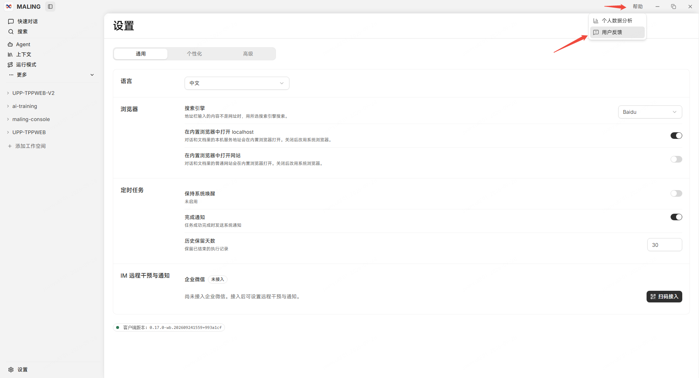

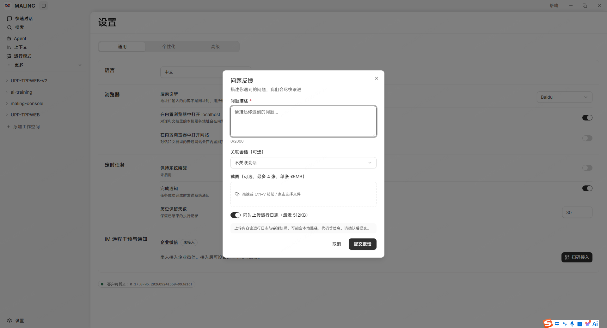

</details>

<a id="data-directories"></a>

### 7.2 日志在哪里？重装前要保留什么？

`~` 表示当前系统用户的主目录。以下是默认位置，设置了对应 home 环境变量时以实际生效目录为准：

| 发行渠道 | 默认用户数据目录 | 日志文件 | 可覆盖目录的环境变量 |
| --- | --- | --- | --- |
| 行内 MALING | `~/.maling/` | `~/.maling/logs/runtime.log` | `MALING_HOME` |
| 开源 Gold Band | `~/.gold-band/` | `~/.gold-band/logs/runtime.log` | `GOLD_BAND_HOME` |

Windows 可以通过文件资源管理器打开用户主目录后，进入对应隐藏目录查找日志。用户目录保存配置、会话和运行记录；项目目录及 worktree 中还可能有未提交的代码修改，二者不是同一份数据。

**保留信息再处理**：常规排障优先使用环境诊断、卡片、继续/恢复和反馈入口。不要直接编辑 `run.json` / `node.json`、删除数据库或清空整个用户数据目录。重装通常不能解决 Agent 登录、网络或项目代码问题。

## 附录：知识库检索与内容维护

### 本文的使用边界

本文件是用户操作和常见问题的知识材料。内网下载地址、npm 镜像、Claude Code 指引及企业域名仅适用于相应组织；不能将它们作为所有用户的通用配置。未完成验证的未来能力不作为现有功能承诺。

供小助手检索时，以问答标题、错误关键词和适用环境定位条目，优先提供对应操作及成功标志；信息不足时补充确认版本/渠道、系统、Agent、运行模式、现象和错误。文档没有覆盖的情况应收集证据转反馈，不推断出不存在的按钮、功能或保证。

### 内容核对与维护入口

| 内容 | 核对来源 |
| --- | --- |
| 操作与能力概览 | [客户端知识库](knowledge-base/README.md)、[功能操作指引](knowledge-base/02-practice/03-功能操作指引.md) |
| 继续、恢复和暂停处理 | [状态与恢复指南](knowledge-base/02-practice/04-状态与恢复指南.md)、[Runtime 控制设计](gold-band/产品设计文档/runtime/control.md) |
| 首次启动流程 | [首次启动引导设计](gold-band/产品设计文档/interaction/app/first-run-onboarding.md) |
| 近期新增能力与适用版本 | [0.20.0 发布说明](../release-notes/0.20.0/zh-CN.md)、[0.21.0 发布说明](../release-notes/0.21.0/zh-CN.md)，再核对对应实现 |
| 飞书 / 企微接入、能力和通知边界 | [IM 远程干预设计](gold-band/产品设计文档/integration/im-remote-intervention.md)、`web/src/components/settings/ImIntegrationSettings.tsx`、`web/src/lib/im-settings.ts` |
| 草稿箱、待发送与打断确认 | `web/src/components/conversation/ComposerDraftBox.tsx`、`web/src/components/conversation/ConversationPromptQueue.tsx`、`web/src/components/settings/PromptQueueSettings.tsx` |
| 菜单和按钮名称 | `web/src/locales/zh-CN.json` 及对应页面实现 |
| 附件数量和体积 | `web/src/lib/attachment-service.ts`、`src-tauri/src/view_models_conversation.rs`，同时核对输入区和发送校验 |
| 渠道入口、更新源和默认数据目录 | `configs/channels/wb.json`、`configs/channels/default.json` |
| 代码图谱接入说明 | 当前渠道的内置 MCP 说明 |

每次更新先核对实际行为，再修改功能速览、对应步骤、Q 条目和问答验收样例；保留稳定的问题锚点。近期功能由速览链接到操作和问答，方便教程阅读与小助手检索。每个关键步骤应有文字说明，截图只辅助定位。截图位于 `docs/assets/sop/`，分享或发布本文时请同时带上该目录；仅用于文本知识检索时，导入 Markdown 正文即可。

### 代表性问答验收样例

| 用户可能怎么问 | 应命中的内容与关键动作 |
| --- | --- |
| “VDI 的 npm 一直超时” | Q01：确认网络和 registry，限定内网镜像适用范围 |
| “我装了 CodeBuddy 还是不能用” | 第 2.2 节 / Q04：CLI 安装、登录、客户端环境诊断逐层确认 |
| “为什么没有思考强度” | Q05：Agent/模型能力，菜单中按需获取模型配置 |
| “停止后发了继续，工作流还是不走” | Q11：普通追问与继续/恢复工作流的区别 |
| “任务设在晚上，电脑关了会跑吗” | Q17：客户端和电脑的运行条件 |
| “企微扫码了，为什么没消息” | Q18：授权账号主动私聊绑定、可用状态、通知类型保存 |
| “怎么用飞书接入，已有应用还是新建” | 第 4.4.1 节：权限确认、扫码选应用、同账号私聊绑定、可用状态 |
| “飞书授权成功，还是等待绑定 / IM_SCOPE_MISSING” | Q22：区分权限和绑定，用本次扫码账号给正确机器人私聊 |
| “换手机账号 / 换机器人应该点哪里” | 第 4.4.5 节 / Q22：重新绑定、重新授权、更换应用分别处理，换应用后重新私聊 |
| “飞书提示连接被占用，是不是多点几次重连” | Q23：先关闭其他设备的同机器人连接，再在本机重连 |
| “Agent 在问我，但企微没有卡片” | Q24：结构化请求、通知开关和渠道表单能力；必要时回桌面回答 |
| “手机已经回答，桌面能再改答案吗” | 第 4.4.4 节 / Q24：先被接受的结果生效，旧卡不覆盖它 |
| “保存到草稿箱为什么还没回答 / 队列不动了” | Q25：保存与发送分开，检查自动发送、暂停和当前回合状态 |
| “升级后之前的卡片都点不了了” | Q26：回桌面处理待处理请求，用新事件验证，不删除数据或直接降级 |
| “升级后会话全没了” | Q16 / 第 7.2 节：用户、渠道和数据目录核对，保留数据 |
